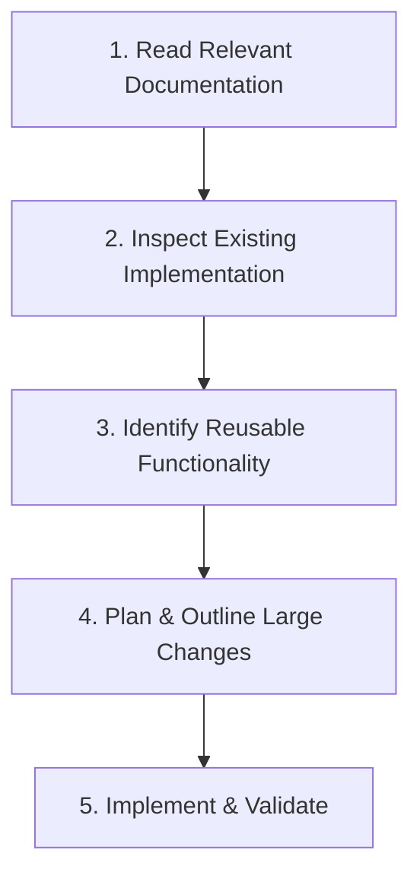

# Project Rules & Engineering Guidelines

This document outlines the mandatory development standards, scientific visualization rules, and operational workflow for this project. All automated assistants and contributors must strictly adhere to these guidelines.

---

## 1. General Principles & Core Rules

1. **Strictly Follow JCI Guidelines**:
   - All plots, figures, and graphical outputs must comply with the specifications in [DESIGN.md](file:///d:/Project%20R%20Folder/MyPhD/LCSC_New/docs/DESIGN.md).
   - Standard dimensions: Max width **179 mm** (2-column) or **86 mm** (1-column), max height **234 mm**.
   - Typography: **Arial**, font size **7–8 pt** (axis labels, legends), minimum **6 pt** (annotations/ticks), **9–10 pt bold** (panel letters A, B, C...).
2. **Use Python for New Implementations**:
   - Write clean, modular Python (Python 3.10+) for data processing, machine learning, statistical testing, and visualization.
   - Use standard scientific libraries: `numpy`, `pandas`, `scipy`, `scikit-learn`, `matplotlib`, and `seaborn`.
3. **Reuse Existing Components**:
   - Prioritize existing data loaders, harmonization scripts, and calculation routines (e.g., CDK multicenter ratio loaders in `scripts/`).
   - Do not duplicate data structures or re-invent existing data transformation pipelines.
4. **Do Not Duplicate Logic (DRY)**:
   - Extract common parameters, file paths, cohort mappings, and plotting setups into shared helper functions or modules.
   - If logic is required across multiple scripts, place it in a shared utility script (e.g., `scripts/jci_style.py` or `scripts/utils/`).
5. **Keep Functions Small & Focused**:
   - Follow the **Single Responsibility Principle**.
   - Functions should ideally be under **30–50 lines**, performing one clear task (e.g., loading data, computing statistics, or rendering a specific plot panel).
   - Use descriptive function names, explicit type hints, and docstrings.
6. **Do Not Modify Unrelated Files**:
   - Keep pull requests and edits strictly scoped to the task at hand.
   - Never reformat, overwrite, or edit unrelated scripts, legacy notebooks, or raw data files.
   - Raw input data (in `Daata/`, `data/`, etc.) is **immutable**; write all generated outputs to `results/`.

---

## 2. Before Coding: Required Workflow

Before writing any new code or making substantial modifications, complete these four steps:



1. **Read Relevant Project Documentation**:
   - Review [DESIGN.md](file:///d:/Project%20R%20Folder/MyPhD/LCSC_New/docs/DESIGN.md) for visualization requirements.
   - Review related R Markdown or Python scripts for data definitions, cohort metadata, and normalization procedures.
2. **Inspect Existing Implementation**:
   - Verify where data is stored and how previous scripts processed it.
   - Check existing output directories in `results/` (e.g., `results/plots/`, `results/tables/`).
3. **Reuse Existing Functionality Where Possible**:
   - Check if an existing function or dataset already provides the required data (e.g., `cdk7_combined_multicenter_ratio_data.csv`).
4. **Make a Plan for Large Changes**:
   - Break down complex tasks into logical, testable steps before editing files.
   - State the target inputs, intermediate transformations, and expected outputs.

---

## 3. Best Practice Suggestions & Recommendations

To maintain research reproducibility, code quality, and seamless journal publication:

### A. Reproducibility & Stochastic Control
- **Explicit Random Seeds**: Always set fixed seeds for stochastic models (e.g., `IsolationForest(random_state=42)`).
- **Environment & Version Tracking**: Document library dependencies in `requirements.txt` or conda environment specifications.

### B. Path Independence & Cross-Platform Execution
- **Use `pathlib.Path`**: Never hardcode operating system-specific absolute paths (e.g., `C:\...` or `d:\...`).
- **Project Root Discovery**: Dynamically resolve paths relative to `Path(__file__).resolve().parent` or `PROJECT_ROOT`.

### C. Scientific Data Integrity & Assertions
- **Input Validation**: Check sample sizes ($n$) and group counts immediately after data loading:
  ```python
  assert len(df) == 44, f"Expected 44 samples, found {len(df)}"
  ```
- **Missing Value Handling**: Explicitly document and log how missing values, zeros, or outliers are handled. Do not drop samples silently.
- **Save Processed Data**: Always export the exact underlying numerical data used in any figure to a `.csv` in `results/tables/` (essential for JCI Source Data requirements).

### D. Multi-Format Figure Export
- **Export Both Vector & Raster**:
  - Save figures as `.svg` or `.pdf` (vector format for JCI composite assembly and editing).
  - Save a companion `.png` at 300 DPI for rapid viewing and markdown integration.
- **Source Data Traceability**: Ensure each plot has an identifiable figure-to-data mapping so statistical claims can be audited.

---

## 4. Summary Checklist for Every Script

- [ ] Applied JCI dimensions (max 179 mm × 234 mm) and Arial 7–8 pt font.
- [ ] No hardcoded local absolute paths; used `pathlib.Path`.
- [ ] Data validation assertions included.
- [ ] Existing pipelines or helper functions reused.
- [ ] Functions are short, typed, and well-documented.
- [ ] Only target files modified; unrelated files untouched.
- [ ] Vector (`.svg`/`.pdf`) and preview (`.png`) saved to `results/plots/`.
- [ ] Source data table saved to `results/tables/`.
