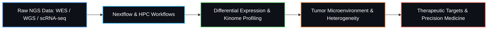

<div align="center">

<!-- HEADER BANNER -->


<!-- DYNAMIC TYPING SVG -->
<a href="https://github.com/arunmhh">
  
</a>

<br/>

<!-- SOCIAL & ACADEMIC BADGES -->
<p align="center">
  <a href="https://orcid.org/0000-0001-9336-7810" target="_blank">
    
  </a>
  <a href="https://www.linkedin.com/in/arun-kumar-a7896a44/" target="_blank">
    
  </a>
  <a href="https://x.com/ArunExcelbiotec" target="_blank">
    
  </a>
  <a href="mailto:kumar.arun@mh-hannover.de">
    
  </a>
</p>

</div>

---

### 🧬 About Me & Research

I am a **PhD Researcher** at **Hannover Medical School (MHH)** (*thesis submission: June 2026*), operating at the intersection of **Cancer Genomics**, **Stem Cell Biology**, and **Computational Data Engineering**.

My research untangles the molecular architecture of **Liver Cancer Stem Cells** through high-dimensional genomic, transcriptomic, and kinomic profiling. I specialize in turning massive raw sequencing datasets into actionable clinical insights and reproducible analytical software.



- 🔬 **Primary Focus**: Cancer stem cell marker identification, tumor heterogeneity, and drug resistance mechanisms.
- 🧬 **Omics Spectrum**: Bulk RNA-seq, Single-Cell RNA-seq (scRNA-seq), WES/WGS variant calling, Microarrays, and Kinome assays.
- ⚡ **Engineering**: Architecting production-grade, containerized pipelines via **Nextflow**, **Docker/Conda**, and **SLURM/HPC**.
- 🤖 **Predictive Modeling**: Applying statistical genetics and machine learning (scikit-learn, XGBoost) to real-world datasets for biomarker discovery.

---

### 🛠️ Technical Ecosystem

<div align="center">
  
</div>

<br/>

| Domain | Technologies & Libraries |
| :--- | :--- |
| **Languages** | `R`, `Python`, `Rust`, `Bash (Shell)`, `SQL` |
| **Bioinformatics & Omics** | `Nextflow`, `Bioconductor`, `Seurat`, `DESeq2`, `tidyverse`, `Scanpy`, `GSEA`, `WES/WGS` |
| **Machine Learning & Stats** | `scikit-learn`, `XGBoost`, `caret`, `randomForest`, `SciPy`, `NumPy`, `Pandas` |
| **Workflow & Infrastructure** | `SLURM (HPC)`, `Docker`, `Conda / Mamba`, `renv`, `Git`, `GitHub Actions`, `AWS` |
| **Databases & Analytics** | `PostgreSQL`, `MySQL`, `MongoDB`, `Power BI`, `Tableau` |
| **Scientific Visuals** | `ggplot2`, `Plotly`, `Seaborn`, `GraphPad Prism`, `Adobe Illustrator`, `Inkscape`, `Figma` |

---

### 📂 Highlighted Projects & Repositories

<table>
  <tr>
    <td width="50%" valign="top">
      <h4>🧪 <a href="https://github.com/arunmhh/HyDDG">HyDDG</a></h4>
      <p>Hypergeometric Distribution for Detecting DEGs — an analytical framework designed to identify differentially expressed genes with statistical precision.</p>
      
      
    </td>
    <td width="50%" valign="top">
      <h4>💻 <a href="https://github.com/arunmhh/codeforytv">codeforytv</a></h4>
      <p>Curated repository of Python & R workflows, Jupyter notebooks, statistical implementations, and computational biology tutorials.</p>
      
      
    </td>
  </tr>
  <tr>
    <td width="50%" valign="top">
      <h4>🗄️ <a href="https://github.com/arunmhh/Reference_app_mongodb">Reference_app_mongodb</a></h4>
      <p>A reference architecture showcasing database integration, NoSQL querying, and structured document storage for complex datasets.</p>
      
      
    </td>
    <td width="50%" valign="top">
      <h4>📊 <a href="https://github.com/arunmhh/R_Statistics.">R_Statistics</a></h4>
      <p>Comprehensive statistical scripts, hypothesis testing models, variance analysis, and publication-ready biological visualization routines in R.</p>
      
      
    </td>
  </tr>
</table>

---

### 📈 GitHub Analytics & Activity

<div align="center">
  <table border="0">
    <tr>
      <td align="center">
        
      </td>
      <td align="center">
        
      </td>
    </tr>
  </table>

  <br/>

  
</div>

---

### 💬 Let's Connect & Collaborate

<div align="center">

```
"Science is not only a disciple of reason but, also, one of romance and passion."
— Stephen Hawking
```

Whether you're looking to discuss **cancer genomics**, build **scalable Nextflow pipelines**, or explore **collaborative research**, feel free to reach out!

[](https://www.linkedin.com/in/arun-kumar-a7896a44/)
[](https://orcid.org/0000-0001-9336-7810)
[](https://x.com/ArunExcelbiotec)
[](mailto:kumar.arun@mh-hannover.de)

<!-- VISITOR COUNTER -->
<br/>


</div>
